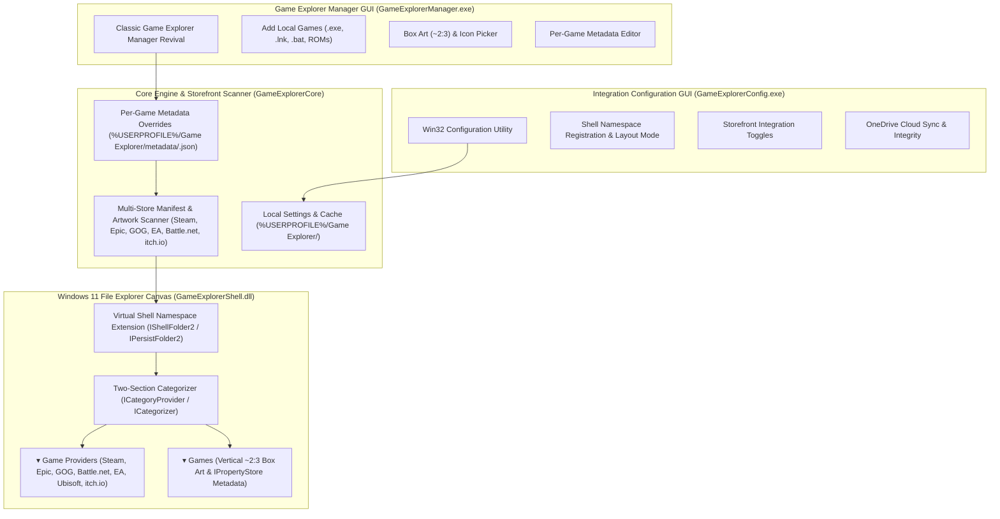

# Architecture — Windows Game Explorer (`projects/windows-game-explorer`)

> Authoritative architectural specification for **Windows Game Explorer** (`projects/windows-game-explorer`).
> Recreates and modernizes the classic Windows 7/Vista Game Explorer (`shell:Games`, `FOLDERTYPEID_Games`) inside Windows 11 File Explorer.
> Triple-component native Windows architecture: File Explorer Shell Extension (`GameExplorerShell.dll`) + Integration Configuration Utility (`GameExplorerConfig.exe`) + Game Explorer Manager GUI (`GameExplorerManager.exe`).
> Generic shortcuts folder degradation is strictly banned by rule.

---

## 1. System Overview & Triple-Component Paradigm



---

## 2. Directory Map

```text
projects/windows-game-explorer/
├── CMakeLists.txt                  # Top-level native CMake build definition
├── include/
│   └── GameExplorerCore/           # Shared headers (Guid.h, Types.h, StorefrontScanner.h, PlatformLauncher.h, etc.)
├── src/
│   ├── core/                       # Core static library (GameExplorerCore)
│   │   ├── Storage.cpp             # User-scoped paths (%USERPROFILE%\Game Explorer\)
│   │   ├── Database.cpp            # Native SQLite wrapper
│   │   ├── Settings.cpp            # Integration configuration persistence
│   │   ├── DarkMode.cpp            # Windows 11 DWM dark mode & system accent helpers
│   │   ├── StorefrontScanner.cpp   # Multi-drive storefront & local artwork scanner
│   │   └── PlatformLauncher.cpp    # Storefront client & direct game launch dispatcher
│   ├── shell/                      # Windows Shell Namespace Extension (GameExplorerShell.dll)
│   │   ├── DllMain.cpp             # DLL entry point, GDI+ lifecycle, COM exports
│   │   ├── ClassFactory.cpp/.h     # IClassFactory for CLSID_GameExplorer & CLSID_GameCategorizer
│   │   ├── ShellFolder.cpp/.h      # IShellFolder2, IPersistFolder2, provider & game PIDL enumeration
│   │   ├── CategoryProvider.cpp/.h # ICategoryProvider & ICategorizer ("Game Providers" vs "Games")
│   │   ├── GameItemUI.cpp/.h       # IThumbnailProvider, IShellItemImageFactory, IPropertyStore, IExtractIconW
│   │   ├── ShellView.cpp/.h        # Custom view & sidepane helpers
│   │   ├── Registration.cpp/.h     # HKCU COM, Namespace, and FolderType registration
│   │   ├── Resource.rc             # Embedded controller icons & version resources
│   │   └── GameExplorerShell.def   # Module definition exports
│   ├── config/                     # Standalone Integration Configuration GUI (GameExplorerConfig.exe)
│   │   └── ConfigMain.cpp          # Integration settings, layout mode, storefront toggles
│   └── manager/                    # Game Explorer Manager GUI (GameExplorerManager.exe)
│       └── ManagerMain.cpp         # Library game manager, local game adder, box art & metadata editor
└── tests/                          # Native C++ unit & integration test suite (GameExplorerTests.exe)
```

---

## 3. Data Flow & Execution Pipeline

1. **Automated Storefront & Provider Discovery**: `StorefrontScanner` crawls all mounted drives for installed digital storefronts (Steam, Epic Games, GOG Galaxy, Battle.net, Ubisoft Connect, EA App, itch.io) and harvests their local manifests and box art directly from disk in ~5ms without external third-party scrapers.
2. **Per-Game Metadata Overrides**: `GameExplorerManager.exe` allows adding local games and customizing any game's title, developer, publisher, release date, rating, launch parameters, and box art via `%USERPROFILE%\Game Explorer\metadata\<appId>.json`.
3. **Two-Section In-Shell Categorization**: `ShellFolder` enumerates installed storefront clients (`itemKind = 0`) and games (`itemKind = 1`), while `GameCategoryProvider` and `GameCategorizer` group them into `▾ Game Providers (N)` and `▾ Games (N)` inside File Explorer.
4. **Authentic Launch Delegation**: Launching a provider opens the storefront client; launching a game invokes the official platform client (`steam.exe -applaunch <appId>`, etc.) or direct executable for DRM-free titles.
