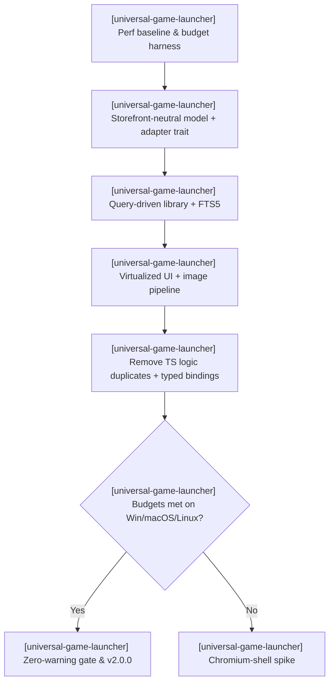
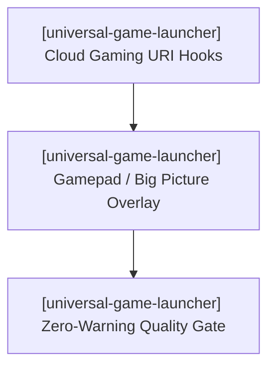

# Universal Game Launcher — Active Sprint Planning

> 🎯 **Living Source of Truth**: Active sprint roadmap, execution architecture, and completed sprint history for **Universal Game Launcher**.
> Pair with [`ROADMAP.md`](./ROADMAP.md) (direction), [`TODO.md`](./TODO.md) (task ledger), and [`BUGS.md`](./BUGS.md) (known issues).

---

## 📜 Tracking Rules

- **100% Active Direction Accuracy**: Reflect the current, active direction of Universal Game Launcher with zero contradictions.
- **Active Sprints Only in Top Section**: `## 🎯 Active Sprints` contains only the currently active sprint. Completed sprints move immediately to `## ✅ Completed Sprints` (newest first).
- **Mandatory Quality Gate**: Compilers and typecheckers must pass with zero errors and zero warnings (`cargo test`, `svelte-check`).

---

## 🎯 Active Sprints

### 🚀 Sprint 32: [universal-game-launcher] — Rust-Owned Core Re-Architecture & Performance Budgets (v2.0.0)
- **Project Identifier:** `[universal-game-launcher]`
- **Repository Path:** `projects/universal-game-launcher`
- **Target Objective:** Make the app run as smoothly as Steam while supporting every game. Move all business logic into the Rust core, switch to a storefront-neutral data model, and make library rendering query-driven and virtualized. Enforce performance budgets, then decide the UI shell by benchmark: stay on Tauri v2, or fall back to a Chromium shell that keeps the Svelte UI.
- **Decision record (2026-10-21):** Framework evaluation complete. Stay on Tauri v2 + Svelte 5; rebuild the core first. A Chromium-shell fallback (Electron + Rust N-API module) is approved only if the budgets fail on an OS after the core rework. Major version bump to `v2.0.0` (breaking data-model migration).

#### 📝 Execution Tasks

1. **[universal-game-launcher] Performance Baseline & Budget Harness**:
   - `[universal-game-launcher]` Seed a 10,000-game mock library; measure cold start, scroll fps, search latency, and idle RAM on the current v1.4.1 build.
   - `[universal-game-launcher]` Codify budgets (cold start < 1.5 s, 60 fps at 10k, search < 50 ms, RAM target) as a repeatable benchmark script.
2. **[universal-game-launcher] Storefront-Neutral Data Model & Adapter Trait**:
   - `[universal-game-launcher]` Introduce a `StoreAdapter` trait (`detect`, `scan`, `launch_spec`, `install_uri`, `uninstall_uri`, `store_uri`) and key `Game` by `(store, store_id)`.
   - `[universal-game-launcher]` Port the existing Steam, Epic, GOG, itch, Xbox, EA, Ubisoft, Battle.net, Amazon, Rockstar, emulation, and manual scanners onto the trait; remove `accountId3` from library, collection, and filter APIs.
   - `[universal-game-launcher]` Write a v1 → v2 SQLite migration that preserves favorites, custom names, overrides, collections, and playtime.
3. **[universal-game-launcher] Query-Driven Library**:
   - `[universal-game-launcher]` `query_library(filter, sort, offset, limit)` + `library_counts()` backed by SQLite FTS5 and covering indices; replace the full `load_library → Game[]` payload.
   - `[universal-game-launcher]` Stream scan and metadata-sync progress via Tauri channels; retire the per-key KV IPC (`redis.ts`) from UI hot paths.
4. **[universal-game-launcher] Virtualized UI & Image Pipeline**:
   - `[universal-game-launcher]` Virtualized sidebar list and library grid (windowed rendering).
   - `[universal-game-launcher]` Rust thumbnail cache (pre-sized, on disk) served via a custom URI protocol; no base64/data-URL artwork.
   - `[universal-game-launcher]` Split monolith files (`commands.rs`, `library/+page.svelte`, `library.scss`) into domain modules.
5. **[universal-game-launcher] Dynamic Multi-Source Scraper & Drop Static Hand-Rolled Repos**:
   - `[universal-game-launcher]` Drop static `HAND_ROLLED_GAMES` and hardcoded metadata catalogs (`developers.rs`).
   - `[universal-game-launcher]` Build dynamic automated scrapers in Rust for indie/standalone titles: itch.io search/scraping, IndieDB API/scraping, VNDB API v2, PCGamingWiki Cargo API, and Wikidata/Wikipedia MediaWiki integration.
   - `[universal-game-launcher]` Field-by-field fallback cascade ensuring full coverage (capsules, hero backgrounds, developers, publishers, genres, release dates) even for obscure itch and indie games.
6. **[universal-game-launcher] Single Source of Truth & Typed Bindings**:
   - `[universal-game-launcher]` Delete the TS duplicates (plugin engine, universal metadata, developers, title normalizer, platform specs) after their Rust equivalents are wired.
   - `[universal-game-launcher]` Generate TS bindings from Rust (`specta` / `tauri-specta`).
7. **[universal-game-launcher] Unified Launch Path**:
   - `[universal-game-launcher]` All launches resolve through `StoreAdapter::launch_spec`; absorbs the open W.56 launcher items and BUG-1 (RuneScape / Jagex Launcher).
8. **[universal-game-launcher] Shell Gate & Release**:
   - `[universal-game-launcher]` Re-run the benchmarks on Windows, macOS, and Linux. If any OS fails, run a time-boxed Chromium-shell spike before release.
   - `[universal-game-launcher]` Zero-warning gate (`RUSTFLAGS="-D warnings" cargo check`, `cargo test`, `npm run check`), then release `v2.0.0`.

---

## ⏳ Queued Sprints

### 🚀 Sprint 31: [universal-game-launcher] — Cloud Gaming Streaming Hooks & Gamepad Handheld Mode (deferred to v2.1.0)
- **Project Identifier:** `[universal-game-launcher]`
- **Repository Path:** `projects/universal-game-launcher`
- **Target Objective:** Expand platform launcher hooks to cloud gaming providers and deliver a controller-friendly Big Picture overlay mode for handheld PCs. Builds on the v2.0.0 adapter trait and virtualized UI. Large-library index tuning and virtualization moved into Sprint 32.

#### 📝 Execution Tasks

1. **[universal-game-launcher] Cloud Gaming & Streaming Integration**:
   - `[universal-game-launcher]` Implement launch handlers and URI schemes for GeForce NOW (`geforcenow://`), Xbox Cloud Gaming (`xbox-cloud://`), and Moonlight/Sunshine streaming connections as `StoreAdapter` implementations.
   - `[universal-game-launcher]` Add cloud streaming provider status indicators to `/library` and `/store`.
2. **[universal-game-launcher] Gamepad / Big Picture Overlay Navigation**:
   - `[universal-game-launcher]` Build full controller navigation supporting standard gamepad buttons (A/B/X/Y, D-pad, bumpers, triggers).
   - `[universal-game-launcher]` Design full-screen Big Picture showcase layout tailored for handheld displays (Steam Deck, ROG Ally, Lenovo Legion Go).

---

## ✅ Completed Sprints

### 🚀 Sprint 30: [universal-game-launcher] — Three-Tier REST API Client Integration & Hand-Rolled Catalog Deprecation (v1.4.1)
- **Delivered (2026-10-16):**
  - Upgraded `src/lib/plugins/metadata/helix-db.ts` to fully leverage the three-tier REST API (`/api/manifest.json`, `/api/v2/` relational discovery, `/api/v3/` dedicated adult tier).
  - Integrated `api.kvSetJson` and `api.kvGetJson` for multi-day local caching of search indices and game payloads with complete offline fallback.
  - Deleted all 28 redundant static developer files (`src/lib/plugins/metadata/developers/*.ts`, 3,000+ lines of static code) in favor of dynamic API resolution.
  - Quality verification: `svelte-check` (0 errors, 0 warnings), `cargo test` (clean).

### 🚀 Sprint 28: [universal-game-launcher] — Universal Core Plugins Architecture & Authentic SVG Platform Icons (v1.4.0)
- **Delivered (2026-10-14):**
  - Consolidated architecture under `src/lib/plugins/` (`platform-universal`, `metadata-universal`, `utility-title-normalizer`, `media-universal`, `utility-gamerpower`, `utility-storage`).
  - Authored authentic vector SVG platform icon variants (`<PlatformIcon />`).
  - Added `⚙ Manage` modal for per-game metadata overrides protected by `userEnhanced: true`.
  - Multi-source automatic metadata cascade across 7+ providers.

### 🚀 Sprint 27: [universal-game-launcher] — Project Script Standards & Manifest Schema (v1.3.3)
- **Delivered (2026-10-10):**
  - Upgraded manifest schema to 1.12.0 and standardized `package.json` scripts to `main:sub:option` format.

### 🚀 Sprint 26: [universal-game-launcher] — Cross-Platform Compiler Warning Elimination (v1.3.2)
- **Delivered (2026-10-06):**
  - Resolved POSIX and Windows compiler warnings (`RUSTFLAGS="-D warnings"`).
