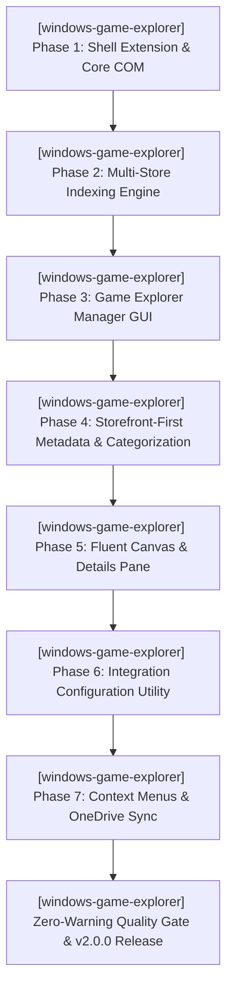

# Windows Game Explorer — Active Sprint Planning

> 🎯 **Living Source of Truth**: Active sprint roadmap, execution architecture, and completed sprint history for **Windows Game Explorer** (`projects/windows-game-explorer`).
> Pair with [`ROADMAP.md`](./ROADMAP.md) (direction), [`TODO.md`](./TODO.md) (task ledger), and [`BUGS.md`](./BUGS.md) (known issues).

---

## 📜 Tracking Rules

- **100% Active Direction Accuracy**: Reflect the current, active direction of Windows Game Explorer with zero contradictions.
- **Active Sprints Only in Top Section**: `## 🎯 Active Sprints` contains only the currently active sprint. Completed sprints move immediately to `## ✅ Completed Sprints` (newest first).
- **Mandatory Quality Gate**: Compilers and linters must pass with zero errors and zero warnings (`MSVC /W4 /WX`, zero warnings treated as errors).
- **Game Library Experience Invariant**: Must provide an authentic, rich game library (two-section categorization, vertical box art, metadata properties); generic shortcuts folder degradation is strictly rejected.

---

## 🎯 Active Sprints

### 🚀 Sprint 32: [windows-game-explorer] — Windows Game Explorer Shell Extension & Lifecycle Management (v2.0.0, W.54)
- **Project Identifier:** `[windows-game-explorer]`
- **Repository Path:** `projects/windows-game-explorer`
- **Target Objective:** Recreate the classic Windows 7/Vista Game Explorer directly inside Windows 11 File Explorer as an authentic, hardware-accelerated Game Library with two collapsible sections (`▾ Game Providers` and `▾ Games`), high-res box art, game properties, and auto-store discovery. Triple-component native C++20 Win32 model: `GameExplorerShell.dll` (in-shell File Explorer extension), `GameExplorerConfig.exe` (integration configuration utility), and `GameExplorerManager.exe` (Game Explorer Manager GUI for managing games and adding local games).
- **Architectural Directive:** Pure native C++20 Windows execution. Storefront-first metadata without external scrapers, native Windows Shell categorization (`ICategoryProvider`/`ICategorizer`), `GameExplorerConfig.exe` for integration configuration, `GameExplorerManager.exe` for game management and local game additions, and OneDrive cloud sync integration.

#### 📝 Execution Tasks

1. **[windows-game-explorer] Phase 1 — Shell Integration & Core Architecture (Pure Native Windows Execution)** ✅:
   - `[windows-game-explorer]` Generate unique GUID/CLSID; implement COM registration (`DllRegisterServer`/`DllUnregisterServer`) mapping shell namespace node beneath Registry (`NameSpace`, `FolderDescriptions`, and navigation pane pinning as a "Games" tab alongside Gallery and Home using custom Fluent SVG controller icon and full Windows 11 light/dark mode support).
   - `[windows-game-explorer]` Implement `IShellFolder2` and `IPersistFolder2` COM interfaces establishing the virtual directory root in File Explorer sidebar.
   - `[windows-game-explorer]` Build native C++20 core library (`GameExplorerCore`) with direct in-memory storefront scanning and user-scoped storage under `%USERPROFILE%\Game Explorer\`.
2. **[windows-game-explorer] Phase 2 — Multi-Store Installed Application Indexing Engine (Zero-Toggle Auto-Discovery)**:
   - `[windows-game-explorer]` Multi-drive storage discovery across all mounted fixed and removable drives (`GetLogicalDriveStringsW`).
   - `[windows-game-explorer]` Steam indexing: parse Registry keys, `libraryfolders.vdf`, and `appmanifest_*.acf` across all drives; link local high-res grid art (`appcache` and `userdata\<id>\config\grid`).
   - `[windows-game-explorer]` Itch.io reader: inspect `%APPDATA%\itch\db\butler.db` and scan `<Drive>\Games\itch\games` supporting niche and visual novel indies with direct executable execution.
   - `[windows-game-explorer]` Epic Games indexing: crawl `%ProgramData%\Epic\EpicGamesLauncher\Data\Manifests\` parsing `.item` configurations.
   - `[windows-game-explorer]` GOG Galaxy & DRM-free indexing: query Registry (`HKLM\SOFTWARE\WOW6432Node\GOG.com\Games`) and drive paths.
   - `[windows-game-explorer]` Square Enix (FFXIV), Battle.net, Ubisoft Connect, and EA App detection across drives.
   - `[windows-game-explorer]` PlatformLauncher hierarchy enforcing client executable in launch path for DRM stores (`steam.exe -applaunch`) and direct execution for DRM-free stores.
3. **[windows-game-explorer] Phase 3 — Game Explorer Manager Companion GUI App (`GameExplorerManager.exe`)**:
   - `[windows-game-explorer]` Dedicated Win32 management companion reviving the classic Game Explorer Manager (GEM) utility.
   - `[windows-game-explorer]` Add local games dialog (`IFileDialog`) for executables (`.exe`, `.bat`, `.cmd`, `.lnk`, ROMs).
   - `[windows-game-explorer]` Visual box art picker: select custom tall box art (~2:3 case format), wide banners, and icons with preview rendering.
   - `[windows-game-explorer]` Metadata editor: edit title, developer, publisher, release date, genre, box rating (ESRB/PEGI/USK), synopsis, arguments, and working directory.
   - `[windows-game-explorer]` Save clean, portable per-game definitions to `%USERPROFILE%\Game Explorer\metadata\<appId>.json`.
   - `[windows-game-explorer]` Library management: customize, hide, unhide, or remove games, and trigger shell namespace updates.
4. **[windows-game-explorer] Phase 4 — Storefront-First Metadata & Native Shell Categorization (No External Scrapers)** ✅:
   - `[windows-game-explorer]` Direct Storefront Data Invariant: Eliminate third-party scrapers (IGDB, VNDB, SteamGridDB); use installed storefront providers (Steam, Epic, GOG, Battle.net, itch.io) directly as the sole source of truth for their games.
   - `[windows-game-explorer]` Harvest local Steam 600×900 vertical box art (`appcache/librarycache/<appId>/library_600x900.jpg`) and hero banners directly from disk with ~5ms scan time.
   - `[windows-game-explorer]` Implement `ICategoryProvider` and `ICategorizer` dividing File Explorer into two authentic collapsible sections:
     - `▾ Game Providers (N)`: Installed storefront clients (Steam, Epic Games, GOG GALAXY, Battle.net, Ubisoft Connect, EA App, itch.io).
     - `▾ Games (N)`: Installed game titles with rich vertical box art and properties.
   - `[windows-game-explorer]` Implement `IThumbnailProvider` and `IShellItemImageFactory` delivering ~2:3 vertical cover art for games and authentic provider logos for storefronts.
   - `[windows-game-explorer]` Implement `IPropertyStore` mapping `PKEY_ItemTypeText` ("Game Providers" vs "Games"), `PKEY_ItemNameDisplay`, `PKEY_Company`, `PKEY_Author`, `PKEY_Rating`, and `PKEY_Size`.
5. **[windows-game-explorer] Phase 5 — Front-End Custom Gallery & Details Side Pane (Native Windows UI)**:
   - `[windows-game-explorer]` Native Fluent Design game view supporting selectable layouts: Cover Art (tall box art ~2:3), Hero Banner (wide ~16:9), and Details View (structured list), with authentic native Windows light and dark styles.
   - `[windows-game-explorer]` Keyboard navigation & Explorer shortcuts (`WM_KEYDOWN`, arrow navigation, Enter launch, F5 refresh, Escape deselect).
   - `[windows-game-explorer]` Contextual details side panel docking to right margin of File Explorer canvas with prominent launch button, store/source badge, and game details.
6. **[windows-game-explorer] Phase 6 — Integration Configuration Utility (`GameExplorerConfig.exe`)**:
   - `[windows-game-explorer]` Standalone lightweight Win32 configuration utility window (native light and dark styles, custom pill window controls, Fluent cards).
   - `[windows-game-explorer]` Shell integration enable/disable toggle (`regsvr32` / HKCU registration) and library layout selector.
   - `[windows-game-explorer]` Storefront integration toggles and OneDrive cloud sync configuration (external scraper API key fields removed).
7. **[windows-game-explorer] Phase 7 — Advanced Execution, OneDrive Sync & OS Integration**:
   - `[windows-game-explorer]` Client-executable launch invocation (`steam.exe -applaunch <appId>`, etc.) and provider client launching.
   - `[windows-game-explorer]` Explorer context menus ("Play Game", "Open Storefront", "Run as Administrator", "Open Game Directory").
   - `[windows-game-explorer]` Dynamic OneDrive cloud-save status badging and profile backup engine.
8. **[windows-game-explorer] Quality Verification & Release**:
   - `[windows-game-explorer]` Enforce zero compiler warnings (`MSVC /W4 /WX` warnings as errors).
   - `[windows-game-explorer]` Author installer managing registry hooks, `GameExplorerShell.dll`, `GameExplorerConfig.exe`, and `GameExplorerManager.exe`.

---

## ⏳ Queued Sprints

### 🚀 Sprint 33: [windows-game-explorer] — Cloud Gaming Streaming Hooks & Gamepad Handheld Mode (deferred to v2.1.0)
- **Project Identifier:** `[windows-game-explorer]`
- **Repository Path:** `projects/windows-game-explorer`
- **Target Objective:** Expand platform launcher hooks to cloud gaming providers (GeForce NOW, Xbox Cloud Gaming) and deliver a controller-friendly Big Picture overlay mode for handheld PCs.

---

## ✅ Completed Sprints

- *Completed sprints prior to the v2.0.0 Native C++ Windows Game Explorer re-architecture are archived in [`CHANGELOG.md`](./CHANGELOG.md).*
