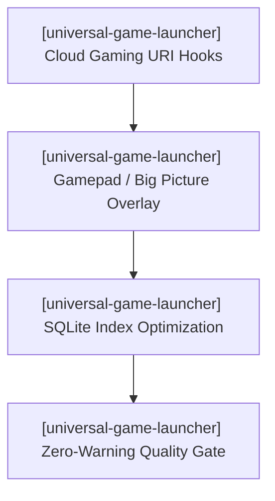

# Universal Game Launcher — Active Sprint Planning

> 🎯 **Living Source of Truth**: Active sprint roadmap, execution architecture, and completed sprint history for **Universal Game Launcher**.
> Pair with [`ROADMAP.md`](./ROADMAP.md) (direction), [`TODO.md`](./TODO.md) (task ledger), and [`BUGS.md`](./BUGS.md) (known issues).

---

## 📜 Tracking Rules

- **100% Active Direction Accuracy**: Reflect the current, active direction of Universal Game Launcher with zero contradictions.
- **Active Sprints Only in Top Section**: `## 🎯 Active Sprints` contains only the currently active sprint. Completed sprints move immediately to `## ✅ Completed Sprints` (newest first).
- **Mandatory Quality Gate**: Compilers and typecheckers must pass with zero errors and zero warnings (`cargo test`, `svelte-check`).

---

## 🎯 Active Sprints

### 🚀 Sprint 31: [universal-game-launcher] — Cloud Gaming Streaming Hooks, Gamepad Handheld Mode & Large-Library Index Tuning (v1.5.0)
- **Project Identifier:** `[universal-game-launcher]`
- **Repository Path:** `projects/universal-game-launcher`
- **Target Objective:** Expand platform launcher hooks to cloud gaming providers, deliver a controller-friendly Big Picture overlay mode for handheld PCs, and optimize SQLite indexing for 10,000+ title libraries.

#### 📝 Execution Tasks

1. **[universal-game-launcher] Cloud Gaming & Streaming Integration**:
   - `[universal-game-launcher]` Implement launch handlers and URI schemes for GeForce NOW (`geforcenow://`), Xbox Cloud Gaming (`xbox-cloud://`), and Moonlight/Sunshine streaming connections.
   - `[universal-game-launcher]` Add cloud streaming provider status indicators to `/library` and `/store`.
2. **[universal-game-launcher] Gamepad / Big Picture Overlay Navigation**:
   - `[universal-game-launcher]` Build full controller navigation supporting standard gamepad buttons (A/B/X/Y, D-pad, bumpers, triggers).
   - `[universal-game-launcher]` Design full-screen Big Picture showcase layout tailored for handheld displays (Steam Deck, ROG Ally, Lenovo Legion Go).
3. **[universal-game-launcher] Large-Library Performance & Virtualization**:
   - `[universal-game-launcher]` Benchmark SQLite query execution across 10,000+ mock records and add covering indices on title, platform, and favorite/hidden flags.
   - `[universal-game-launcher]` Optimize list virtualization in `/library` to maintain steady 60fps scrolling on low-power APUs.

---

## ✅ Completed Sprints

### 🚀 Sprint 30: [universal-game-launcher] — Three-Tier REST API Client Integration & Hand-Rolled Catalog Deprecation (v1.4.1)
- **Delivered (2026-10-16):**
  - Upgraded `src/lib/plugins/metadata/helix-db.ts` to fully leverage the three-tier REST API (`/api/manifest.json`, `/api/v2/` relational discovery, `/api/v3/` dedicated adult tier).
  - Integrated `api.kvSetJson` and `api.kvGetJson` for multi-day local caching of search indices and game payloads with complete offline fallback.
  - Deleted all 28 redundant static developer files (`src/lib/plugins/metadata/developers/*.ts`, 3,000+ lines of static code) in favor of dynamic API resolution.
  - Quality verification: `svelte-check` (0 errors, 0 warnings), `cargo test` (clean).

### 🚀 Sprint 28: [universal-game-launcher] — Universal Core Plugins Architecture & Authentic SVG Platform Icons (v1.4.0)
- **Delivered (2026-10-14):**
  - Consolidated architecture under `src/lib/plugins/` (`platform-universal`, `metadata-universal`, `utility-title-normalizer`, `media-universal`, `utility-gamerpower`, `utility-storage`).
  - Authored authentic vector SVG platform icon variants (`<PlatformIcon />`).
  - Added `⚙ Manage` modal for per-game metadata overrides protected by `userEnhanced: true`.
  - Multi-source automatic metadata cascade across 7+ providers.

### 🚀 Sprint 27: [universal-game-launcher] — Project Script Standards & Manifest Schema (v1.3.3)
- **Delivered (2026-10-10):**
  - Upgraded manifest schema to 1.12.0 and standardized `package.json` scripts to `main:sub:option` format.

### 🚀 Sprint 26: [universal-game-launcher] — Cross-Platform Compiler Warning Elimination (v1.3.2)
- **Delivered (2026-10-06):**
  - Resolved POSIX and Windows compiler warnings (`RUSTFLAGS="-D warnings"`).
