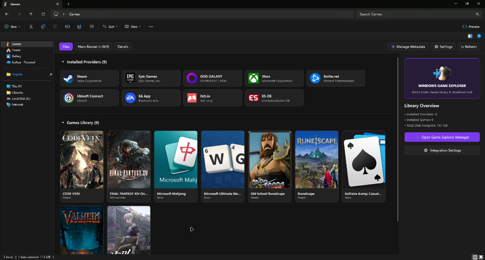

<div align="center">

# Windows Game Explorer

<p align="center">
  <a href="https://github.com/HELIX-Origin/windows-game-explorer/releases"></a>
  <a href="https://opensource.org/licenses/MIT"></a>
  
  
</p>

**A native C++ Windows Game Explorer reviving the classic Windows 7/Vista Game Explorer directly inside Windows 11 File Explorer.**

Organize, browse, and launch your entire multi-platform game library with high-resolution box art, rich preview pane, and automated storefront detection without scraping or credentials.

<br />



</div>

---

## ⚡ Quick Start

### Prerequisites
- Windows 11 (Build 22000+)
- Visual Studio 2022 / Build Tools (C++20 MSVC v143+)
- CMake 3.25+

### Building Locally
```powershell
cmake -B build -S .
cmake --build build --config Release
```

### Running Tests
```powershell
.\build\tests\Release\GameExplorerTests.exe
```

---

## 🤝 Community & Governance

- [Contributing](./CONTRIBUTING.md) · [Code of Conduct](./CODE_OF_CONDUCT.md) · [Support](./SUPPORT.md)
- [Security Policy](./SECURITY.md) · [Privacy Policy](./PRIVACY.md) · [Terms of Service](./TOS.md)
- [Changelog](./CHANGELOG.md) · [Governance](./GOVERNANCE.md) · [Citation](./CITATION.cff) · [License](./LICENSE)

---

## ⚖️ License

[MIT](LICENSE) — Copyright (c) 2026, HELIX Origin.
