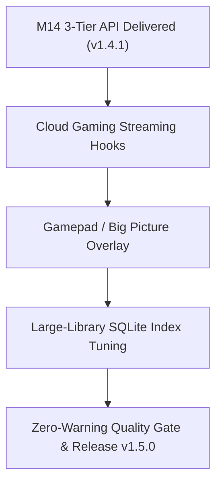

# Universal Game Launcher — Roadmap & Milestones

> 🗺️ **Living Source of Truth**: Product direction, positioning principles, and milestone delivery history for **Universal Game Launcher**.
> Pair with [`PLAN.md`](./PLAN.md) (sprint execution), [`TODO.md`](./TODO.md) (task ledger), and [`BUGS.md`](./BUGS.md) (issues and quirks).

---

## 📜 Tracking Rules

- **100% Active Direction Accuracy**: `ROADMAP.md`, `PLAN.md`, `TODO.md`, and `BUGS.md` reflect the current, active state of Universal Game Launcher with zero contradictions.
- **Self-Contained Repository Memory**: Universal Game Launcher tracks its own product roadmap and development sprints independently.
- **Mandatory Quality Gate**: Zero compiler warnings (`RUSTFLAGS="-D warnings"`), zero Svelte diagnostics warnings.
- **License**: Strictly licensed under **MIT**.

---

## 🔭 Vision & Positioning Principles

1. **Core Value Proposition**: A unified, high-performance cross-platform desktop gaming hub built on Tauri v2 (Rust + Svelte 5 + modular SCSS). Aggregates titles from across all major PC storefronts and emulation cores with automatic metadata cascade, high-resolution artwork caching, and privacy-first local persistence.
2. **Design Principles**:
   - **Native App Isolation**: The application never writes to, modifies, or backs up external launcher proprietary files (`shortcuts.vdf`, `cloud-storage-namespace-1.json`, etc.). All data persists in our local SQLite database (`database.sqlite`) and in-memory serverless Redis-compatible KV tier (`mem_kv`).
   - **Universal Core Plugins**: Core capabilities are structured as modular plugins (`platform-universal`, `metadata-universal`, `utility-title-normalizer`, `media-universal`, `utility-gamerpower`, `utility-storage`).
   - **Zero In-App Transactions**: Installations, updates, launches, and purchases delegate strictly to official storefront clients or system browsers.
   - **Obsidian Dark SCSS**: Aesthetic coherence with `#07111f` / `#0d1b2d` background, cyan (`#48d8f2`) and purple (`#b06cff`) accents, and authentic vector SVG platform icons (`<PlatformIcon />`).

---

## 🗺️ Milestone Overview

| # | Milestone | Scope | Status | Version / Target | Focus |
|---|---|---|---|---|---|
| **M1–M9** | Foundation through v1.0.0 Packaging | Desktop core | ✅ Shipped | `v1.0.0` | Tauri v2 scaffold, multi-platform discovery, SQLite cache, obsidian UI |
| **M10** | Store Deals & Free Games Engine | Deals engine | ✅ Shipped | `v1.3.1` | Multi-platform free game checker, store deals engine, inline settings |
| **M11** | Zero-Warning Compiler Hardening | Quality gate | ✅ Shipped | `v1.3.2` | Warning elimination across Windows and POSIX targets |
| **M12** | Manifest Schema & Script Standards | Tooling | ✅ Shipped | `v1.3.3` | Canonical `main:sub:option` script taxonomy, manifest schema 1.12.0 |
| **M13** | Universal Plugins & Platform SVG Icons | Plugin system | ✅ Shipped | `v1.4.0` | Universal Core Plugins, Authentic Vector SVG icons, `⚙ Manage` modal |
| **M14** | HELIX Gaming DB 3-Tier API & KV Cache | Metadata API | ✅ Shipped | `v1.4.1` | Three-tier REST client, serverless KV offline cache, hand-rolled purge |
| **M15** | Cloud Gaming Hooks & Handheld Overlay | Handheld/Cloud | 🚀 Active | `v1.5.0` | Cloud streaming hooks (GeForce NOW, Xbox), Gamepad Big Picture mode |
| **M16** | Emulator Auto-Configuration Presets | Emulation | ⏳ Planned | `v1.6.0` | Standalone emulator presets (RetroArch, Dolphin, PCSX2, RPCS3) |

---

## 🚀 Active Milestones

### [universal-game-launcher] — Milestone M15: Cloud Gaming, Handheld Mode & Large-Library Performance (v1.5.0)

#### Detailed Deliverables

- 🎯 **[universal-game-launcher] Cloud Gaming & Streaming Hooks**:
  - Direct URI launcher integrations for GeForce NOW, Xbox Cloud Gaming, and Moonlight/Sunshine.
- 🎯 **[universal-game-launcher] Gamepad / Handheld Big Picture Mode**:
  - Full controller navigation (D-pad, analog stick, bumper tabs) optimized for handheld PC gaming devices (Steam Deck, ROG Ally, Lenovo Legion Go).
- 🎯 **[universal-game-launcher] Large-Library Performance Tuning**:
  - Incremental SQLite index optimizations and virtualization for libraries exceeding 10,000 titles.

---

## 📌 Historical Milestones & Shipped Releases

### [universal-game-launcher] — Milestone M14: 3-Tier REST Client & Serverless KV (v1.4.1)
- Integrated HELIX Gaming DB three-tier REST client with dynamic shard discovery across volume shards (`00` through `03`).
- Built persistent serverless KV offline fallback (`api.kvSetJson`, `api.kvGetJson`).
- Deleted 28 redundant static developer files in favor of dynamic API resolution.

### [universal-game-launcher] — Milestone M13: Universal Core Plugins & Authentic SVG Icons (v1.4.0)
- Consolidated Universal Core Plugins architecture under `src/lib/plugins/`.
- Authored custom authentic vector SVG platform icon variants (`<PlatformIcon />`).
- Built `⚙ Manage` per-game customization modal with `userEnhanced: true` protection.
- Deployed multi-source automatic metadata cascade across 7+ providers.
