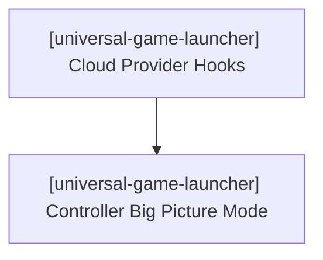

# Universal Game Launcher — Task Checklist & Workstream Tracking

> 📋 **Living Source of Truth**: Actionable task ledger for **Universal Game Launcher**.
> Statuses: ⬜ backlog · 🚧 in progress · ✅ done (tracked as `- [ ]` and `- [x]` checkboxes).
> High-level direction lives in [`ROADMAP.md`](./ROADMAP.md), active sprints in [`PLAN.md`](./PLAN.md), issues in [`BUGS.md`](./BUGS.md).

---

## 📜 Tracking Rules

- **100% Active Direction Accuracy**: Task items and checklists must reflect the current state of Universal Game Launcher with zero contradictions.
- **Normalized Directives**: Rewrite user directives into clean, self-contained engineering requirements.
- **Done Moves Down**: Completed items are marked with `- [x]` and archived when workstreams finish.
- **Zero-Warning Gate**: All builds and tests must pass with 0 errors and 0 warnings (`cargo test`, `svelte-check`).

---

## 🔥 Active Workstreams

### 🎯 [universal-game-launcher] Workstream W.57: Rust-Owned Core Re-Architecture & Performance Budgets (v2.0.0)
- **Project Identifier:** `[universal-game-launcher]`
- **Repository Path:** `projects/universal-game-launcher`
- **Status:** 🚧 In progress (user directive 2026-10-21). Takes priority over W.55; absorbs the open W.56 launcher items and BUG-1.
- **Target Component:** Rust core (`src-tauri/src/`) + Svelte UI (`src/`)

**Locked user directives (normalized by domain):**
- **Product goal**: A fast, modern unified library for every game and every storefront on Windows, macOS, and Linux that runs as smoothly as Steam while supporting every game possible.
- **Launch model**: Games launch through their storefront's own client/launcher (protocol URI or official launcher executable), so the app never needs internal authorization or stored credentials.
- **Framework decision (delegated to agent, recorded 2026-10-21)**: Stay on Tauri v2 + Svelte 5 and rebuild the core first. Decide the UI shell by benchmark. A Chromium shell (Electron + Rust N-API core, Svelte UI kept) is the approved fallback only if an OS misses the performance budgets after the core rework.
- **Versioning**: The breaking data-model migration ships as `v2.0.0`.

**Implementation checklist:**
- [ ] **[universal-game-launcher] 1. Performance Baseline & Budgets**:
  - [ ] `[universal-game-launcher]` 10k-game mock library seeder + benchmark script (cold start, scroll fps, search latency, idle RAM).
  - [ ] `[universal-game-launcher]` Record the v1.4.1 baseline; codify budgets (cold start < 1.5 s, 60 fps at 10k, search < 50 ms, RAM target).
- [ ] **[universal-game-launcher] 2. Storefront-Neutral Model & `StoreAdapter` Trait**:
  - [ ] `[universal-game-launcher]` Define `StoreAdapter` (`detect`, `scan`, `launch_spec`, `install_uri`, `uninstall_uri`, `store_uri`); key `Game` by `(store, store_id)`.
  - [ ] `[universal-game-launcher]` Port Steam, Epic, GOG, itch, Xbox, EA, Ubisoft, Battle.net, Amazon, Rockstar, emulation, and manual scanners onto the trait.
  - [ ] `[universal-game-launcher]` Remove `accountId3` from library, collection, and filter APIs.
  - [ ] `[universal-game-launcher]` v1 → v2 SQLite migration preserving favorites, custom names, overrides, collections, and playtime.
- [ ] **[universal-game-launcher] 3. Query-Driven Library**:
  - [ ] `[universal-game-launcher]` `query_library(filter, sort, offset, limit)` + `library_counts()` on SQLite FTS5 + covering indices.
  - [ ] `[universal-game-launcher]` Replace the full `load_library → Game[]` payload in the UI.
  - [ ] `[universal-game-launcher]` Stream scan/metadata progress over Tauri channels; remove per-key KV IPC (`redis.ts`) from UI hot paths.
- [ ] **[universal-game-launcher] 4. Virtualized UI & Image Pipeline**:
  - [ ] `[universal-game-launcher]` Virtualized sidebar list and library grid.
  - [ ] `[universal-game-launcher]` Rust thumbnail cache served via a custom URI protocol (no base64/data URLs).
  - [ ] `[universal-game-launcher]` Split `commands.rs`, `library/+page.svelte`, and `library.scss` into domain modules.
- [ ] **[universal-game-launcher] 5. Dynamic Multi-Source Scraper & Drop Static Repositories**:
  - [ ] `[universal-game-launcher]` Remove static hand-rolled games (`HAND_ROLLED_GAMES`) and hardcoded developer dictionary (`developers.rs`).
  - [ ] `[universal-game-launcher]` Implement dynamic scrapers in Rust for non-Steam and indie titles (itch.io search/store scraping, IndieDB API/scraper, VNDB API v2, PCGamingWiki, Wikipedia/Wikidata).
  - [ ] `[universal-game-launcher]` Automatic multi-source fallback cascade so indie and itch games have complete artwork (capsule, hero), developer, publisher, and genre coverage without manual intervention.
- [ ] **[universal-game-launcher] 6. Single Source of Truth & Typed Bindings**:
  - [ ] `[universal-game-launcher]` Delete the TS duplicates (plugin engine, universal metadata, developers, title normalizer, platform specs) once their Rust equivalents are wired.
  - [ ] `[universal-game-launcher]` Generate TS bindings from Rust (`specta` / `tauri-specta`).
- [ ] **[universal-game-launcher] 7. Unified Launch Path**:
  - [ ] `[universal-game-launcher]` All launches resolve via `StoreAdapter::launch_spec`; implement the remaining W.56 launchers (Jagex, XIV Launcher, FFXIV official, GW2 official) and fix BUG-1.
- [ ] **[universal-game-launcher] 8. Shell Gate & Release**:
  - [ ] `[universal-game-launcher]` Re-benchmark on Windows, macOS, and Linux; run a time-boxed Chromium-shell spike if any OS fails.
  - [ ] `[universal-game-launcher]` Zero-warning gate (`RUSTFLAGS="-D warnings" cargo check`, `cargo test`, `npm run check`) and release `v2.0.0`.

---

### 🎯 [universal-game-launcher] Workstream W.55: Cloud Gaming Streaming Hooks & Gamepad Handheld Mode (Queued — v2.1.0, after W.57)
- **Project Identifier:** `[universal-game-launcher]`
- **Repository Path:** `projects/universal-game-launcher`
- **Target Component:** Core Launcher & UI

**Implementation checklist:**
- [ ] **[universal-game-launcher] 1. Cloud Gaming URI Integration**:
  - [ ] `[universal-game-launcher]` Implement launch handlers and URI schemes for GeForce NOW, Xbox Cloud Gaming, and Moonlight/Sunshine (as `StoreAdapter` implementations).
  - [ ] `[universal-game-launcher]` Add cloud provider pills and status badges to library game cards.
- [ ] **[universal-game-launcher] 2. Gamepad & Big Picture Overlay**:
  - [ ] `[universal-game-launcher]` Implement gamepad input driver supporting standard controllers (Xbox, DualShock/DualSense, Switch Pro).
  - [ ] `[universal-game-launcher]` Design full-screen Big Picture layout tailored for handheld displays (Steam Deck, ROG Ally, Legion Go).
- [ ] **[universal-game-launcher] 3. Quality Verification**:
  - [ ] `[universal-game-launcher]` Verify zero errors and zero warnings across `npm run check` and `RUSTFLAGS="-D warnings" cargo check`.

---

### [universal-game-launcher] Workstream W.56: Platform-Native Game Launching and Auto-Detected Launchers
- **Project Identifier:** [universal-game-launcher]
- **Repository Path:** projects/universal-game-launcher
- **Status:** In progress (user directive 2026-10-21). Remaining launcher items are delivered through W.57 §6 (`StoreAdapter::launch_spec`).
- **Target Component:** Core Launcher (Rust) + Settings UI (Svelte)

**Locked user directives (normalized by domain):**
- **Platform-native launch**: Games on platforms that require their store/launcher (Steam, Epic, Battle.net, Ubisoft, EA, Rockstar, Amazon, Xbox, Jagex Launcher, XIV Launcher, FFXIV official launcher, Guild Wars 2 official launcher, etc.) MUST be launched through the official launcher executable/protocol so DRM, overlays, and account injection work. Direct binary execution is only a fallback for platforms that permit it (itch.io, GOG, Standalone, Other).
- **Steam account injection**: Steam games must invoke steam.exe directly with steam://run/{appid} (not cmd /c start) so the logged-in account is passed to the game.
- **Auto-detection**: Launchers/stores/platforms are auto-detected; they no longer need to be enabled/disabled/displayed as toggles in Settings.
- **Legendary optional toggle**: Legendary CLI support is an optional setting (legendary_enabled) that bypasses the Epic Games Launcher method.
- **API keys in Settings**: Settings must expose fields for Steam Web API key, Guild Wars 2 API key, IGDB client id/secret, and other game API keys required for full support.
- **Additional launchers**: Add support for Jagex Launcher, XIV Launcher, Square Enix FFXIV official launcher, Guild Wars 2 official launcher, etc.
- **Capabilities**: Tauri capabilities folder verified present and correct (default.json with opener plugin); only the opener plugin is used.

**Implementation checklist:**
- [x] [universal-game-launcher] Steam games launch via steam.exe steam://run/{appid} (account injection).
- [x] [universal-game-launcher] Reorder launch_game so store-required platforms skip direct-exe-first.
- [x] [universal-game-launcher] Add legendary_enabled, gw2_api_key, jagex_launcher_path, xiv_launcher_path to Settings.
- [ ] [universal-game-launcher] Implement direct-executable invocation for Epic, Battle.net, Ubisoft, EA, Rockstar, etc.
- [ ] [universal-game-launcher] Add Jagex Launcher, XIV Launcher, FFXIV official, GW2 official launcher support.
- [ ] [universal-game-launcher] Remove launcher enable/disable toggles from Settings UI; rely on auto-detection.
- [ ] [universal-game-launcher] Add API key input fields (Steam Web API, GW2, IGDB, etc.) to Settings UI.
- [ ] [universal-game-launcher] Research correct invocation for each launcher/store and document.
- [ ] [universal-game-launcher] Quality gate: cargo check + npm run check with 0 warnings.

---

## ✅ Completed Workstreams

### 🎯 [universal-game-launcher] Workstream W.53: Helix Gaming DB Three-Tier REST API Integration & Hand-Rolled Catalog Deprecation (Release v1.4.1)
- **Delivered (2026-10-16):**
  - [x] `[universal-game-launcher]` Upgraded `src/lib/plugins/metadata/helix-db.ts` to support `/api/manifest.json`, `/api/v2/` relational discovery, and `/api/v3/` dedicated adult tier.
  - [x] `[universal-game-launcher]` Implemented in-memory caching (`cachedV2Index`, `cachedV3Index`) and persistent KV fallback (`api.kvSetJson`, `api.kvGetJson`).
  - [x] `[universal-game-launcher]` Deleted all 28 redundant static developer files (`src/lib/plugins/metadata/developers/*.ts`, saving 3,000+ lines of static code).
  - [x] `[universal-game-launcher]` Streamlined `developers/index.ts` with lightweight studio profiles preserving matching algorithms.
  - [x] `[universal-game-launcher]` Quality verification: passed `svelte-check` (0 errors, 0 warnings), `cargo test` clean.

### 🎯 [universal-game-launcher] Workstream W.49: Universal Core Plugins, Authentic SVG Platform Icons & Per-Game Customization (Release v1.4.0)
- **Delivered (2026-10-14):**
  - [x] `[universal-game-launcher]` Consolidated Universal Core Plugins architecture under `src/lib/plugins/`.
  - [x] `[universal-game-launcher]` Authored authentic vector SVG platform icon variants (`<PlatformIcon />`).
  - [x] `[universal-game-launcher]` Multi-source automatic metadata cascade (Local Engine, Libretro Thumbnails, Steam Store, GOG, Wikipedia, PCGamingWiki, ProtonDB).
  - [x] `[universal-game-launcher]` Implemented `⚙ Manage` per-game customization modal with `userEnhanced: true` protection.

### 🎯 [universal-game-launcher] Workstream W.47: Project Script Standards & Manifest Schema 1.12.0 (Release v1.3.3)
- **Delivered (2026-10-10):**
  - [x] `[universal-game-launcher]` Canonical `main:sub:option` scripts, schema 1.12.0 validation, `.vscode` untracking, release CI.

### 🎯 [universal-game-launcher] Workstream W.46: Cross-Platform Compiler Warning Elimination (Release v1.3.2)
- **Delivered (2026-10-06):**
  - [x] `[universal-game-launcher]` Resolved compiler warnings across POSIX and Windows targets with zero warnings.

### 🎯 [universal-game-launcher] Workstream W.45: Multi-Platform Free Game Checker & Deals Engine (Release v1.3.1)
- **Delivered (2026-10-02):**
  - [x] `[universal-game-launcher]` Per-platform checkers, deals engine (`utility-gamerpower`), patch notes feed, sidebar cog.
